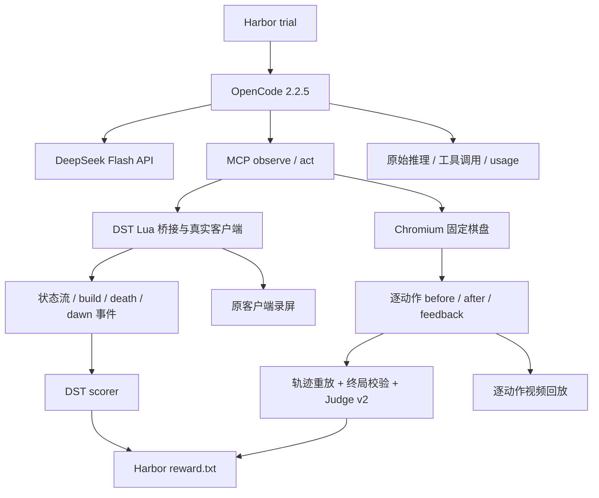

# 游戏环境 Agent Benchmark 构造与评测：DST 与沉星之序关卡

版本：2026-11-15。执行机器：a800-server1。被测 Agent：OpenCode 2.2.5；模型：DeepSeek Flash（请求选择器 `deepseek/deepseek-flash`，DST API 实际返回 `deepseek-flash`）。

## 摘要

本项目整理了两种不同交互时序的游戏评测：真实 DST 单人离线客户端的首夜生存任务，以及《沉星之序》Heroes and Artifacts 7 的固定棋盘网页移植任务。两者都已有真实 Harbor 模型试跑、轨迹及自动判分代码。DST 本轮 reward=0.30、success=false；沉星之序关卡模型试跑的历史终局分为 0，接入 Judge v2 后对同条轨迹重评分为 0.24，success=false。后者的成功参考轨迹得 1.00。

这些分数衡量不同任务中的特定里程碑，不能横向解释为“30% 与 24% 的通关能力”。本发布是可核验的工程实验交付，不是已经通过全部严格商业游戏 Benchmark 验收的完成声明：DST 使用结构化观察而非截图输入，启动同步发生过人工修复，完整起点自动恢复尚未接入每次 `harbor run`；沉星之序环境是网页移植，规则与商业原版的一致性未完成逐项验收。报告将已验证事实、工程缺口和后续验收条件分别列明。

## 1. 交付与考核要求对照

| 要求 | DST | 沉星之序关卡 |
|---|---|---|
| 边界清晰的任务切片 | 第一天采集、制斧、建火并存活至第二天清晨 | 固定 Heroes and Artifacts 7，两名英雄分别占据两个出口 |
| 确定性初始化 | 固定 seed 和完整世界/角色存档已封存；每局自动恢复未完成 | 固定 board.json，SHA-256 校验，浏览器每局从初态加载 |
| 商业游戏环境 | 真实正版 Linux 客户端、离线世界 | 网页移植；不声称是商业游戏客户端 |
| 多模态输入 | 当前为局部结构化状态；录像仅用于事后观察 | 模型接收棋盘/HUD 截图和公开动作反馈 |
| Harbor 目录结构 | task.toml、instruction、environment、tests、solution 均提供；solution 明确报未验收 | 完整目录，含由已验证成功轨迹构成的 reference solution |
| 自动 Judge | 独立游戏事件产生 reward；当前信任外部游戏服务 | 全轨迹重放、独立终局条件、v2 过程分 |
| 实际模型评测 | Harbor reward=0.30，含一次退出异常 | 原始试跑 0 exceptions；历史终局 reward=0；v2 离线 0.24 |
| 视频及轨迹一致性 | 原客户端完整录屏，另附注释版 | 保存状态的逐动作回放，附本地渲染与 WikiTactics 渲染两版 |
| 发布镜像 | Agent/桥接运行镜像；游戏本体、Steam 会话及私有存档不公开分发 | 固定网页关卡和 Agent 运行依赖镜像 |

因此，本交付可支持检查代码、重新计算历史分数、运行网页关卡、在有正版游戏环境的 A800 上继续运行 DST。它尚不能满足“任意新机器无需准备、两款商业原版、每次单条命令自动复位且全程无干预”的更强验收标准。

## 2. 为什么选择这两个切片

### 2.1 DST：把长程生存收缩到一个昼夜

从主菜单操作或开放式长期生存开始，会把登录、世界生成和随机探索混入 Agent 能力得分。首夜任务把主要依赖链收缩为：发现资源 → 区分采集与拾取 → 准备工具材料 → 制作并使用斧头 → 收集木材 → 建造并维持火源 → 管理饥饿与夜间危险。

起点是 Wilson、第 1 天秋季清晨、空背包、生命 150、饥饿 150、理智 200；seed 为 **341784114**，游戏 build 为 **762172**。正式目标要求夜间在自己建造的燃烧营火 6 个世界单位内累计停留至少 30 游戏秒，并在下一次清晨仍存活、生命≥50、饥饿≥20。死亡立即终止，不允许复活后继续。

seed 只约束地图生成的一部分。角色、资源剩余状态、世界时钟、季节事件和游戏版本同样会影响初态。因此本项目封存完整 Cluster 和角色快照 `0000000003`，归档 SHA-256 为 `99b902f93a3a1ee234845a32a3d5e6d4fb87b652d679d9fdcfedabfeefcfebdf`。该存档在准备阶段对现有未开展任务的世界重置清晨和满状态；它不是来自一次已通关参考策略的验证起点。未来复测应关闭游戏后恢复整份快照，并核对初始观察，而不能仅重新填写 seed。

### 2.2 沉星之序：固定棋盘的机制组合

任务来自 Heroes and Artifacts 7 的固定布局，包含 Gemsman、Wizard、Rod、巨石与两个出口。动作不是单纯找最短路：模型需要发现角色差异、通过交换和推动改变物件相对位置、保留另一名角色的可达性，最后同时完成两个出口条件。

它具有机制组合与空间规划的区分度，但不能代表原作数十小时的全部系统，也不覆盖原作多世界流程。当前实现采用公开的 Joric 引擎和关卡专用扩展，许可文件随仓库保留；网页画面由本地 renderer 绘制。WikiTactics 渲染视频用于复盘，不能作为游戏规则正确性的证据。

## 3. 环境与交互架构

### 3.1 DST 的观察、动作和时序

Lua 代码运行在游戏主模拟端。它读取角色状态、背包、半径 25 内的对象以及制作配方，按 0.5 游戏秒上报。命令轮询频率为每 0.25 游戏秒；移动调用原生寻路，动作使用 BufferedAction 和 Builder，不直接修改资源数量或瞬移角色。

动作白名单包括 move、pick、pickup、craft、equip、chop、eat、cook、fuel、wait。移动单次最多 30 世界单位，建造点最多距角色 6 单位；制作只开放 axe、campfire、torch。每次工具调用等待 0.5–15 墙钟秒后返回状态，动作可能还在执行。模型输入里出现实体 ID，是结构化接口能力，不是视觉识别能力。

本轮选择实时模式：模型推理期间游戏原则上继续运行。按正常游戏时间，一昼夜约 480 秒；墙钟计时与游戏计时分别记录。Xvfb 画面录制为 1280×720、10 FPS，观察采样频率与录像帧率是两件不同的事。此次启动时的暂停菜单导致这项原则没有从第一条模型观察起完全成立，不能事后把暂停时间删除来伪造正常实时评测。

当前 Harbor Agent 容器连接已有游戏容器的 HTTP 桥接服务，地址可通过 `DST_BRIDGE_URL` 指定。这个外部服务不是 Harbor 每局创建的独立世界，因而存在状态复用风险。对历史分数的核验可依赖封存事件；未来新模型试跑必须先执行起点恢复和启动握手。

### 3.2 沉星之序的观察、动作和时序

模型每次获得 920×930 的本地棋盘与 HUD 截图，以及当前角色与动作反馈。服务端不会把完整棋盘对象状态作为文本直接交给模型；精确 before/after 状态只写入 artifacts，供事后重放。

动作白名单为 up、down、left、right、switch、activate、undo、reset，共 8 个离散值。状态只在动作执行时转移，模型思考不会改变棋盘，因此适合离散步进。300 次动作与 1800 秒限制共同约束推理；undo、reset 也计入动作。与 DST 相比，这里的慢思考主要消耗推理预算，而不会让角色在无人操作时因天黑受伤。

OpenCode 通过工具策略禁用 shell、读写文件、浏览器与网页搜索等旁路，只开放对应 MCP 服务。这是策略层约束，不等于经过证明的操作系统级隔离。正式公开排行榜还需限制 Agent 用户对 scorer、reference solution 和私有 artifacts 的文件访问，并使用分离的 verifier 容器。

## 4. Judge 设计及验收证据

### 4.1 DST：事件证据和一次性里程碑

| 条件 | 奖励 | 证据来源 |
|---|---:|---|
| 曾分别持有草≥3、树枝≥1、燧石≥1 | 0.10 | 背包历史数量最大值 |
| 自己制作斧头 | 0.20 | builditem(axe) |
| 制斧后持有木材≥2 | 0.15 | 背包数量 |
| 自己建造营火 | 0.15 | buildstructure(campfire) |
| 夜间靠近自己的燃烧营火累计≥30秒 | 0.10 | 游戏时间、距离、营火状态 |
| 全部前提完成，并健康活到次日清晨 | 0.30 | 世界周期与角色状态 |

评分器检查事件序号单调、起始事件存在、终止事件与里程碑集合；里程碑用集合去重，避免重复制造刷分。死亡保留已经取得的部分分，终局成功单列 `success`。没有终止事件的轨迹输出 complete=false；verifier 不应把“游戏没有启动”解释成正常失败分数。

这是一套基于可信观察器的 scorer，并非能够独立重建 DST 物理的验证器。输入文件若由 Agent 自行伪造，Python scorer 无法仅靠文件内容识别。正式评测需要封闭事件写入接口、为每局绑定 episode ID 和起点哈希、让模型无法写入 verifier 输入，并验证事件与录像/状态流一致。

已完成的单元检查覆盖成功、去重、死亡终止、空等、未完成、invalid。此次真实 trial 的游戏事件得到 0.30，Harbor verifier 也写入 0.3。尚缺一个从固定基线真实采集到首夜成功的 oracle 轨迹，因此仓库的 DST `solution/solve.sh` 明确退出并说明未验收，不会凭空生成成功奖励。

### 4.2 沉星之序：先重放，再给过程分

Verifier 从固定 board.json 重新启动浏览器，核对初态、动作白名单、动作数量、每步 before/after 与反馈，以及最后的 latest 快照。终局逻辑另行检查两名英雄是否分别占据两个不同出口，而不是直接信任页面的 `won` 字段；同时要求两者一致。

这能检测篡改动作序列和状态日志，但重放仍使用同一套转移实现。它不能排除“环境与重放器共享同一个错误规则”的情况。证明商业原版一致性需要原版对照实验，或者独立实现的转移模型和规则测试集。

Judge v2 在完整性通过后计算诊断性过程分。成功直接 1；未成功时对每个单一状态计算里程碑，整条轨迹只取最大值，不对重置或重复访问累计加分。

| 单一状态中的最佳进展 | 分数 |
|---|---:|
| 任一英雄持有 Rod | 0.05 |
| 巨石向左移动至少两格 | 0.18 |
| 一名英雄在出口 | 0.24 |
| 巨石进入左出口接近通道 | 0.40 |
| 两英雄分别进入两侧出口列的接近区域 | 0.55 |
| 一人在出口、另一人距另一个出口一步 | 0.75 |
| 两英雄同时占据两个出口 | 1.00 |

真实 `test.sh` 已按“独立重放 → Judge v2 → reward.txt”串联。成功参考轨迹 97 个 MCP 动作得 1.00；模型 thinking-low 轨迹 222 动作重评分 0.24；非 thinking 轨迹 217 动作重评分 0.05；空轨迹为 0。历史 Harbor 的终局二值结果保持原值，绝不把离线重评分改写为历史在线 reward。

v2 权重是基于本关结构与已有轨迹设计的，存在事后选择偏差；当前没有多关卡和多条独立成功路径校准。生产版还应独立检查 elapsed_s 单调与时限、不可达状态、不合法字段、超限轨迹和伪造终局，并提前冻结权重。

## 5. 实测结果与成本口径

| 指标 | DST 首夜 | 沉星之序 thinking-low |
|---|---:|---:|
| 本次分析对应动作数 | 34 次提交 | 222 次 |
| 是否通关 | 否 | 否 |
| 历史 Harbor reward | 0.30 | 0 |
| v2 离线重评分 | 不适用 | 0.24 |
| Harbor 运行异常数 | 1 | 0 |
| 推理配置 | thinking enabled / low | thinking enabled / low |
| 输入类型 | 结构化局部状态 | 当前棋盘截图与反馈 |

DST API 原始记录包含 33 次完成且返回 usage 的调用、43 次请求尝试；prompt=518,036、completion=6,865、total=524,901 tokens。累计包含缓存输入及 OpenCode 辅助请求。Harbor 的 Agent 统计口径略有不同，例如把缓存与部分推理字段分列，不能把两个统计表直接相加。

沉星之序原始 job 记录 n_input_tokens=8,103,275、n_cache_tokens=7,958,912、n_output_tokens=7,043。cache 已是输入中的复用部分，不应再次叠加为总输入。上述为单次轨迹成本账目，不是相同预算条件下的模型优劣比较。

DST 本轮在启动调通期间把原草案的 50k 总 token 预算改为 500k，最后一个在途请求导致越过阈值。游戏 start 到 timeout 约 220.8 游戏秒，预算监控墙钟约 341.8 秒；仍处于第一天白天。超预算后停止 API 重试，Harbor 留下 NonZeroAgentExitCodeError，同时 verifier 成功产出 0.3。预算修改与干预均保留在原始记录中。

## 6. DST 失分的事件级归因

### 6.1 已表现出来的能力

模型能根据局部对象列表选择附近树苗，移动到草丛，并在缺少燧石时逐步探索。最初对地面燧石使用 pick 没有取得物品，随后识别出植物采集与地面拾取的区别，改用 pickup。游戏端记录 starter_materials；随后 craft(axe) 触发 crafted_axe，两项合计 0.30。这些结论分别由动作参数、背包状态和独立事件支持。

### 6.2 机制操作失误与桥接反馈共同造成循环

装备步骤传入 `item`，而工具说明约定用 `target` 指定要装备的背包物品，模型收到失败反馈后尝试直接砍树。后续状态显示斧头已经装备，不能仅依据早期装备错误把所有失败都归结为“没有装备斧头”。

关键问题发生在批量砍树循环：模型的停止条件是“背包出现 log”或“目标实体 ID 不再存在”。真实游戏中砍倒树不会自动把木材放入背包；倒下后的树实体仍存在，最终状态里同一 ID 的 `chop=false`，附近出现地面 log。两个停止条件都没有满足，于是继续尝试对同一目标砍树。

这同时暴露了三层问题：模型没有把“砍树→地面掉落→拾取”完整拆解；循环没有使用观察中已有的可砍伐标志；桥接层对无效持续动作未及时返回明确失败，仍显示 running。最后一项是环境工程缺陷，不应算作模型独有缺陷。录像中的地面木头与背包缺少木材相互印证，因此没有获得“持有≥2木材”的奖励是符合当前 Judge 的。

### 6.3 实验配置对结果的影响

启动 inactive/暂停菜单问题消耗了模型请求与预算；OpenCode 累计完整上下文使 prompt tokens 快速增长；500k 上限在首夜之前耗尽。此次无法据此判断模型是否能在正常启动、更紧凑上下文或更充分预算下建火过夜，也不能把 timeout 说成角色死亡。最终生命仍为150、饥饿约115.63。

建议采用“动作完成或明确失败才返回”的协议、对目标状态变更发出事件、工具返回紧凑状态差分，并把启动握手放在模型计费回合之前。每项改动应单独做对照，避免同时改变动作抽象、预算和记忆策略后把提升归因于单一因素。

## 7. 沉星之序失分的状态级归因

thinking-low 的222次调用产生128次有效行走、7次交换、4次Rod推动；在第140步让一名英雄抵达出口。223个含初态的状态里有133个不同状态，表明它并非只在一个位置重复输入。

但主要瓶颈是物件的全局依赖规划。成功参考在第31步把巨石移动至左侧，在第70步进入左出口接近通道，然后组合交换和Rod完成双出口。模型轨迹的巨石只在初始位置及其右侧一格之间变化，没有形成进入左侧通道的布局。它会使用局部机制，但没有稳定建立“先安排巨石和通道，再安排两个角色”的整体计划。

状态跟踪也带来开销：6次reset、10次undo、39次未改变局面的动作。原始 reasoning 在第138–140步附近记录了把 Gemsman 误当成 Wizard、忘记切换的自我纠正，与随后动作一致。它能纠正局部角色判断，但角色、朝向与目标的持续绑定不稳。

非 thinking 轨迹217动作、98次未改变局面、最高只取得Rod，v2为0.05。两次运行均只有一个样本，不能据此宣称 thinking 导致成功率提升。0.24与0.05反映这两条具体轨迹的最佳已达里程碑，不是统计显著的普适能力结论。

## 8. 视频、轨迹与证据链

DST 提供原始连续录屏与新增注释版。注释版在画面下方添加独立栏，按34次动作的墙钟时间显示 Step、参数、中文推理摘要和结果，不遮挡游戏HUD。模型推理摘要由实际 reasoning_content 整理，现场观察与事后诊断分开标注。它保留原速与完整时长约6分2秒。

沉星之序提供两种逐动作回放：本地浏览器版对应评测 renderer；WikiTactics 版借用网站 renderSVG 与贴图，把已保存的状态重新绘制。后者不是商业客户端录屏，也不是网站引擎对模型动作的独立重新求解。视频呈现的是完整动作序列，不应从回放播放时长推断原始推理延迟。真实执行动作、原始 reasoning 和时间记录以 JSONL 为准。

轨迹证据包括：Harbor job/trial配置与结果、OpenCode原始输出、模型请求/返回、工具动作、状态流、独立评分事件、Judge报告和文件哈希。公开仓库不包括 API 密钥、Steam登录状态和商业游戏本体。原始证据与当前工程改动分开保存，防止用修改后的代码冒充历史运行版本。

## 9. 复现与发布

代码仓库：<https://github.com/CostaliyA/game-bench-harbor>。

镜像归档：<https://huggingface.co/datasets/CostaliyA/game-bench-harbor-images>。HF托管的是 `docker save` 导出的压缩归档，不是声称提供了一个通用Docker Registry。下载后校验SHA256，再用 `docker load` 导入；命令详见仓库 README 和 images/IMAGE_BUILD.md。

网页关卡可在准备好Docker、Harbor及DeepSeek API凭据后执行；DST另需合法安装的游戏、固定存档与运行中的桥接服务。凭据通过环境变量提供，不写进镜像或仓库。当前发布允许独立重算已保存DST分数，网页关卡则可在容器内完整重放判分。

最低验证层次应是：格式加载检查 → 已有正/负轨迹重评分 → oracle运行 → 新模型运行 → 跨两次初始化比较初态。本次发布版在A800重新执行了两份配置dry-run，并实际运行OOTSS oracle Harbor trial：1 trial、0 exceptions、reward=1.00；也对既有模型轨迹重新运行test.sh得到0.24。DST事件独立重算为0.30。验证文件见validation/。没有执行的项目不以“理论上支持”替代通过结论。

## 10. 下一阶段可验收标准

1. **DST 自动复位**：每个 trial 独立复制只读快照，加载后比对 seed、build、角色、背包、时间和局部状态；失败时不启动模型。至少两次启动得到相同初态哈希。
2. **DST 接口和参考解**：补充完整动作状态机，针对倒树、无效目标、寻路失败和动作中断做实机测试；用真实采集与制作参考策略完成首夜，验证reward=1和死亡/空等反例。
3. **模态定义**：若考核多模态，新增截图输入评测组；与结构化状态组分开命名、分开报告，不能把录像存在当成模型使用视觉的证据。
4. **沉星之序规则一致性**：列出商业原版与网页移植的机制对照表，分别测试交换、Rod推动、边界、朝向、角色切换、undo/reset；未完成前保留“移植任务”标识。
5. **Judge 抗投机**：隔离参考解和私有事件写入；加入篡改状态、倒序时间、重置刷分、伪造终局、超限动作等负例；无效轨迹与正常失败分开统计。
6. **实验协议冻结**：预先锁定预算、模型版本标识、提示词、动作空间、时间模式和权重；至少5个固定起点或关卡、每组多次采样，分别报告成功率、过程分、有效动作率、耗时与token。

## 参考来源

- Harbor Tasks 规范：<https://docs.harborframework.com/tasks/overview>。目录布局和reward输出约定以官方文档及A800安装版本为准。
- Hugging Face 上传接口：<https://huggingface.co/docs/huggingface_hub/guides/upload>。本项目用dataset repository保存可加载镜像归档。
- 原关卡展示与回放资源：<https://sinkingstar.wikitactics.com/areas/heroes-and-artifacts/#heroes-and-artifacts-7>。
- DeepSeek thinking接口：<https://api-docs.deepseek.com/guides/thinking_mode/>。
- 本仓库原始记录：results/dst、results/ootss、docs/ootss-original-report.md。因果分析以这些具体轨迹为依据；本文未新增模型回合，也未把旧结果改写成新试验。
