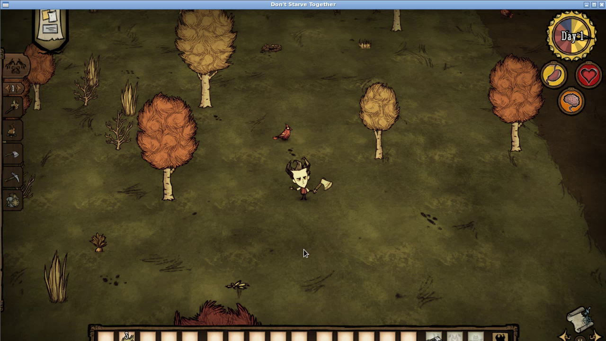
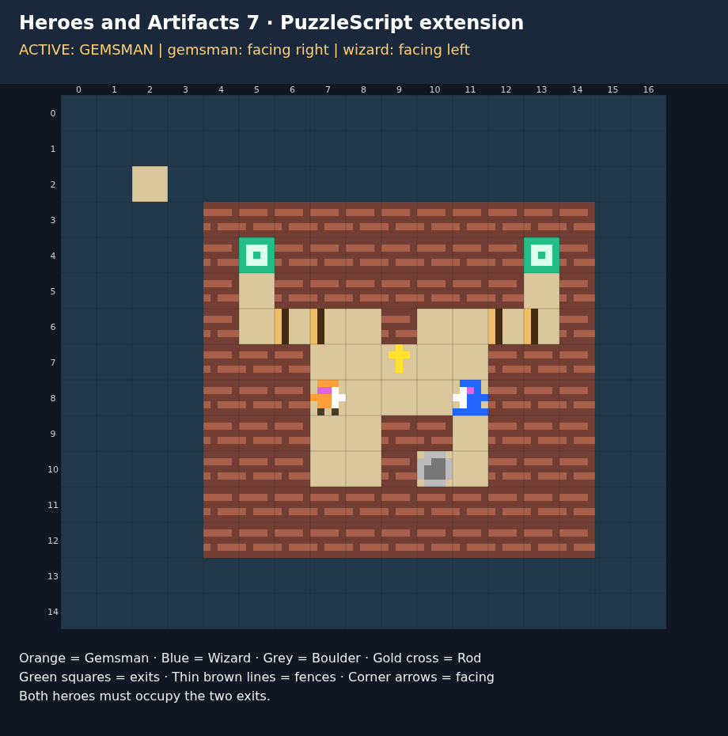
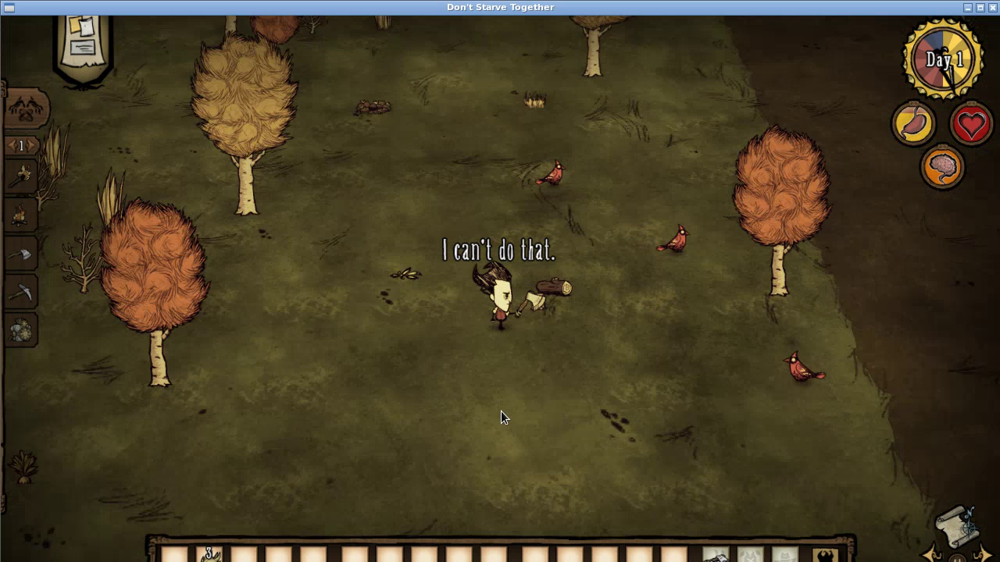

[下载排版版 PDF](Game_Bench_Harbor_Report.pdf) · [原始工程审计](TECHNICAL_AUDIT.zh-CN.md)

游戏环境 Agent Benchmark · 技术报告

# 饥荒与沉星之序 Agent 评测环境构造与分析

Sandbox 实现、任务设计与模型实测

## 任务分析

本项目将两款游戏中的有限任务接入 Harbor，构造可交互、可复现、可自动判分的 Agent 评测环境。任务设计需要保留游戏中的核心决策难点，同时明确初始状态、动作边界与成功条件。

饥荒属于持续运行的开放世界。资源采集、工具制作与生存目标存在前置依赖，动作还受距离、对象状态和昼夜变化影响。因此，评测选取“从空背包完成首夜生存”作为任务，部署真实 DST 客户端，通过 Lua 桥接提供局部状态和原生动作接口，保留资源消耗与实时模拟。

沉星之序属于规则驱动的空间谜题。固定关卡的动作集合有限，但角色交换、物件推动与出口位置共同约束可行路径。因此，评测选取 Heroes and Artifacts 7 双角色关卡，由我使用 Agent，结合人类先验和公开攻略复现规则与棋盘，以离散步进方式检查多步空间规划。

两类环境分别采用游戏事件核验与确定性轨迹重放进行评分。实验使用 OpenCode 作为 Agent harness，接入 DeepSeek V4.1 Flash，保存模型推理、动作、状态与过程视频，以定位任务进展及失败环节。

01 / 游戏差异

## 游戏机制与交互时序

### 开放世界：资源依赖与持续变化

饥荒的决策对象包括植物、地面物品、工具和建筑，同一资源在不同状态下对应不同操作。例如，树需要装备斧头后砍伐，掉落的木材需要另行拾取，进入背包后才能用于建火。Agent 必须同时判断对象、动作前提和完成条件，并在局部观察中寻找缺失资源。



图 1　DST 实测画面，约 04:10。模型已收集材料并制斧，后续需取得木材与建立营火。



### 规则谜题：角色协作与空间约束

Heroes and Artifacts 7 包含两名角色、两个出口、巨石和 Rod。棋盘整体可见，但可行路径取决于当前角色、朝向、持有物及物件位置。

交换或推动会改变后续通路。单人接近出口并不一定推进整体目标，有时必须先让位或调整巨石，为另一名角色建立路径。难点集中在规则归纳与动作顺序，而非操作种类。

图 2　本项目复现关卡的初态：两名角色需要借助巨石与 Rod，分别到达两个出口。

两者的时间约束也不同：DST 在模型推理期间继续运行，探索和重复操作会占用白天；沉星之序在等待动作时保持静止，可使用更长推理进行空间推演。前者要求在时间压力下更新计划，后者要求维持跨步骤的状态一致性。

01 / 从游戏结构到任务切片

## 能力要求与任务边界

| 比较项 | 饥荒 / DST | 沉星之序关卡 |
| --- | --- | --- |
| 环境结构 | 开放世界，局部可见；资源、角色与昼夜持续变化。 | 有限棋盘；角色与物件遵循显式规则。 |
| 动作空间 | 移动、采集、拾取、制作、装备、砍树、进食、烹饪、加燃料等；动作带实体或坐标参数。 | 四方向移动、角色切换、激活、撤销、重置，共 8 个离散动作。 |
| 时序 | 实时运行；推理与动作执行共同消耗游戏时间。 | 离散步进；模型思考时棋盘保持不变，动作执行后才转移状态。 |
| 关键能力 | 局部探索、资源依赖规划、对象交互、动作完成判断、生存压力下的调度。 | 未知规则归纳、角色与朝向跟踪、空间推演、跨角色的因果规划。 |
| 主要风险 | 观察已经过时；动作没做完；资源掉在地上却误认为已取得。 | 局部移动正确，但全局布局错误；混淆当前角色，反复撤销或重置。 |

### DST：依赖链与时间预算

首夜任务从第 1 天清晨、空背包开始，要求按“材料—斧头—木材—营火”推进。资源位置决定探索路径，剩余白昼决定行动优先级。Agent 既要分解依赖关系，也要在寻路、采集和建造后确认实际结果，及时处理目标失效。

### 沉星之序：联合状态与因果规划

双出口任务要求共同安排两名角色与物件的位置。动作是否合法只是第一层判断，还需预测其是否保留后续解法。撤销和重置允许试探，但有效探索需要记住失败布局及其原因，避免重复进入无进展的状态。

### 环境实现与验证方式

DST 的资源消耗、寻路、动作动画和昼夜系统相互耦合，部署原游戏能保留这些机制，接口层主要处理状态采样与异步执行。沉星之序的固定棋盘可表示为有限状态转移，适合通过规则复现控制初态和逐步回放。相应地，前者使用游戏事件验证里程碑，后者通过动作重放检查状态与终局。

02 / Sandbox 构造

## DST：原生模拟与动作桥接

正版 DST Linux 客户端在 A800 上以单人离线世界运行，Xvfb 提供显示环境，Lua 代码在主模拟端访问角色和实体。外部 Agent 通过 MCP 调用观察和动作工具，HTTP 服务负责交换状态与命令。


### 原生动作封装

桥接层将命令转成游戏原生的 `BufferedAction`、寻路和 `Builder` 调用。例如，`pick` 用于植物采集，`pickup` 用于拾取地面物品；`craft` 检查配方和材料，再由原游戏消耗材料。模型无需处理每一次鼠标定位，但仍要选对对象和动作。

| 接口约束 | 本轮设置 |
| --- | --- |
| 局部观察 | 半径 25 世界单位；背包、生命/饥饿/理智、附近实体与制作配方。 |
| 移动与建造 | 单次移动不超过 30 单位；建造点距角色不超过 6 单位。 |
| 采样与录制 | 状态每 0.5 游戏秒采样；命令每 0.25 游戏秒轮询；录像为 10 FPS。 |
| 调用返回 | 等待 0.5–15 墙钟秒后返回状态；返回时原生动作可能尚未完成。 |

### 初始状态与存档恢复

本轮 seed 为 **341784114**，build 为 **762172**。我封存了世界和 Wilson 的完整快照：第 1 天秋季清晨、空背包、生命 150、饥饿 150、理智 200。只固定地图 seed，无法固定已经被采走的资源、角色位置和游戏时钟；重复实验应恢复同一份存档。

本轮启动时修复了暂停同步；存档快照已封存，按 trial 自动恢复基线尚未接入。

02 / Sandbox 构造

## 沉星之序：关卡规则复现

我在 Joric 公开引擎与关卡资料基础上，使用 Agent 试玩、生成代码和调试，结合自身规则理解及网上攻略复现固定关卡。实现过程中由我补充机制约束、检查异常，并校验动作结果。


### 状态转移实现与验证

实现分为棋盘数据、转移规则和渲染三部分。`board.json` 保存固定布局；Joric 引擎与关卡扩展处理行走、Wizard 交换、Rod 推动以及切换、撤销和重置；浏览器渲染棋盘和 HUD，MCP 只向被测模型返回截图与公开动作反馈。

状态转移表示为 `sₜ₊₁ = T(sₜ, aₜ)`。固定初态与动作序列后，Judge 逐步重放并核对记录状态，定位首次不一致的步骤。

### 参考解与环境验收

依据公开攻略构造参考路径，展开角色切换后共 97 个 MCP 动作，存入 `solution/`，仅供环境验收使用。发布版通过 Harbor 执行参考解，得到 **reward=1.00、0 个运行异常**。

规则、初态与动作转移由代码统一控制，便于构造回归轨迹和定位规则错误。参考解通过验证了环境内部的可解性；交换、推动和朝向等机制与商业原版的一致性仍需逐项对照。

03 / 任务与 Reward

## 任务目标与奖励定义

### DST：首夜任务的依赖链

目标是从空背包建立营火，并活到第 2 天清晨。奖励按一次性里程碑累计，重复制作、丢下再捡起不会重复计分；只有满足全部前提并健康存活，才能得到最后的终局奖励。

| DST 判据 | 奖励 | 游戏端证据 |
| --- | --- | --- |
| 曾分别持有草≥3、树枝≥1、燧石≥1 | 0.10 | 背包数量历史最大值 |
| 自己制作斧头 | 0.20 | builditem(axe) |
| 制斧后背包持有木材≥2 | 0.15 | 背包数量 |
| 自己建造营火 | 0.15 | buildstructure(campfire) |
| 夜间在自己的燃烧营火 6 单位内累计≥30秒 | 0.10 | 时钟、距离和燃烧状态 |
| 全部达成；次日清晨存活，生命≥50、饥饿≥20 | 0.30 | 世界周期与角色状态 |

### 沉星之序：终局条件与关卡过程分

通关要求两名英雄同时占据两个不同出口。Judge v2 先校验轨迹，再对每个单一状态计算进展，整条轨迹只取最大值。重置、撤销和反复进入同一状态不能累积奖励。

| 同一状态中达到的进展 | 分数 |
| --- | --- |
| 任一英雄取得 Rod / 巨石向左移动至少两格 | 0.05 / 0.18 |
| 一名英雄进入出口 / 巨石进入左出口接近通道 | 0.24 / 0.40 |
| 两人分别进入两侧出口列接近区域 | 0.55 |
| 一人在出口，另一人距另一个出口一步 | 0.75 |
| 两人同时占据两个出口 | **1.00** |

Judge v2 对历史轨迹进行事后重评分；过程分表示关卡里程碑，不是解题完成比例。阈值仍需更多合法解法与失败轨迹校准。

03 / 实验组织

## 评测框架与实验配置


两任务均使用 Harbor 组织环境、执行 Agent 并收集 verifier 输出。OpenCode 2.2.5 作为 harness，负责维持模型上下文、展示 MCP 工具和执行工具调用。模型为 DeepSeek V4.1 Flash（配置名称），API 标识 `deepseek-flash`；thinking 开启，reasoning effort 为 low。

### 任务目录

```text
task/
├── task.toml
├── instruction.md
├── environment/
├── solution/
└── tests/test.sh
```

### 目录职责

`task.toml` 描述资源与时限；`instruction.md` 给出目标与约束；`environment/` 构建交互环境；`solution/` 放参考解；`test.sh` 调用 Judge，将结果写入 Harbor 读取的 `reward.txt`。

| 实验设置 | DST | 沉星之序 |
| --- | --- | --- |
| 观察与时序 | 局部结构化状态，实时运行 | 截图与反馈，离散步进 |
| 本轮结果 | 0.30；未通关 | 历史终局 0；v2 重评 0.24 |
| 动作数 | 34 次提交 | 222 次 |
| 约束 | 本轮调整至 500k 累计 API token；1800秒墙钟 | 300 次动作；1800秒墙钟 |
| 验证方式 | 可信游戏事件与独立 scorer | 重放所有动作，核对状态与终局 |

### 判分依据与可信边界

DST scorer 依据独立观察器的事件判分，事件日志写入权应与 Agent 隔离。沉星之序 Judge 使用同一转移实现重放动作，再检查状态记录及双出口终局。

DST 最终累计 524,901 token，在途请求越过 500k 阈值后停止，Harbor 记录一次退出异常，verifier 正常产出得分。两任务的观察模态、时序和奖励定义不同，得分用于各自任务内的诊断。

03 / DST 轨迹分析

## DST：资源准备与动作执行失效



图 3　最后阶段的真实游戏画面。树已砍倒，木材留在地上；背包里有草和斧头，但没有达到“持有 2 根木材”的条件。

| 步骤 | 动作与反馈 | 计分结果 |
| --- | --- | --- |
| 8–18 | 移动、采草并寻找燧石；对地面燧石从 pick 改为 pickup。 | 材料 +0.10 |
| 19 | craft(axe)，真实消耗材料，触发制作事件。 | 制斧 +0.20 |
| 20–22 | 装备参数曾用错；随后靠近并砍树。 | 无新增奖励 |
| 23–34 | 循环砍同一实体，没有转去拾取掉落物。 | 最终 0.30 |

> “Let's loop chop until log appears in inventory or tree gone, max 12 swings.”DeepSeek 原始推理摘录，砍树循环之前。

模型将“背包出现木材”或“树的 ID 消失”设为停止条件，但砍树不会自动拾取木材，倒下后的实体 ID 也仍存在。最终观察已包含 `chop=false` 与地面 log，动作仍未切换到拾取。材料与制斧所得的 0.30 表明模型能执行前置步骤；后续失分则暴露出状态变化未能及时修正执行计划的问题。

BALROG 将模型能够回答机制问题、却未在行动中运用相应知识的现象概括为知识与行动脱节。[[1]](https://arxiv.org/html/2411.13543v1#S4.SS1) 本轮轨迹呈现的具体问题是反馈未进入下一步决策：地面木材和目标失效信息均未促成动作切换，桥接层持续返回 running 又强化了重复执行。GameWorld 对实时交互的分析也强调接口反馈与推理延迟对执行结果的影响。[[2]](https://arxiv.org/html/2604.07429v1) 本轮在白天因 token 预算终止，未覆盖夜间生存决策。

03 / 沉星之序轨迹分析

## 沉星之序：局部进展与全局规划


0.24

第 140 步达到的最佳里程碑

蓝色 Wizard 已进入左侧出口，另一名角色仍在中部，巨石没有进入左出口接近通道。

图 4　第 140 步的关卡状态。单人进入出口得 0.24；两人同时到达才算成功。

> “Oops active hero was Gemsman, not Wizard! We forgot switch after activate…”DeepSeek 原始 reasoning 事件 57，对应第 138–140 步；随后执行角色切换并继续移动。

模型从受阻反馈中发现角色混淆，切换后让一名英雄进入出口，获得 0.24。但在全部 222 次动作中，巨石只出现在初始位置和右侧一格。参考解在第 31 步已将巨石向左移动两格，第 70 步进入左出口接近通道；模型始终未完成这一空间准备。

| 轨迹现象 | 证据 | 反映的问题 |
| --- | --- | --- |
| 能使用机制 | 128 次有效行走、7 次交换、4 次 Rod 推动 | 已能正确使用部分局部机制 |
| 反复回退与试探 | 6 次重置、10 次撤销、39 次未改变局面 | 角色状态跟踪和预期结果检查不稳 |
| 缺少全局进展 | 巨石未进入左侧关键通道 | 局部有效动作没有组成完整的因果计划 |

模型的主要失分来自局部操作未组成满足双出口条件的整体计划。BALROG 观察到的复杂空间推理和系统探索困难，为反复回退但关键物件未取得进展提供了分析视角。[[1]](https://arxiv.org/html/2411.13543v1#S4.SS1) GameWorld 同样发现，部分进展往往无法转化为稳定通关。[[2]](https://arxiv.org/html/2604.07429v1) 本轮反复撤销和重置并未形成稳定的布局推进，提示后续策略需要将角色状态记忆与子目标检查结合：每段动作后核对关键物件是否按预期变化，并据此保留或修订计划。

讨论 / 复现入口

## 结论与后续验证

本轮 DeepSeek 能完成资源准备、工具使用和局部纠错，但在持续执行中未能稳定维持任务进展：DST 的资源链停在砍树与拾取之间，沉星之序未形成通向双出口的协作布局。

两款任务各分析一条 thinking-low 轨迹，结论适用于本轮执行中的失败机制，尚不足以估计一般通关率。后续实验应先完善环境验收，再通过重复运行评估策略改进。

### 后续验证

DST 应先接入快照恢复与启动检查，修正动作完成、失败和目标失效反馈，再以首夜成功策略及死亡、空等反例核验评分。沉星之序应补齐规则对照，并在固定关卡中比较显式状态记录、短计划核验和无进展重规划的效果。扩展到多次运行后，报告成功率、里程碑进展和交互成本。

本项目形成了两种可追溯的评测路径：原生模拟通过游戏事件核验过程，规则复现通过确定性重放核验状态。二者将任务得分与具体动作、反馈和推理关联，为后续区分环境问题与模型策略问题提供依据。

### 代码、视频与参考资料

[1] [BALROG: Benchmarking Agentic LLM and VLM Reasoning On Games](https://arxiv.org/html/2411.13543v1#S4.SS1)，§4.1。 [2] [GameWorld: Towards Standardized and Verifiable Evaluation of Multimodal Game Agents](https://arxiv.org/html/2604.07429v1)，§4.5、§7。

代码与完整证据：[github.com/CostaliyA/game-bench-harbor](https://github.com/CostaliyA/game-bench-harbor) 镜像归档：[huggingface.co/datasets/CostaliyA/game-bench-harbor-images](https://huggingface.co/datasets/CostaliyA/game-bench-harbor-images)

关卡与攻略参考：[WikiTactics · Heroes and Artifacts 7](https://sinkingstar.wikitactics.com/areas/heroes-and-artifacts/#heroes-and-artifacts-7)。复现所使用的公开引擎许可保留在仓库的 JORIC-LICENSE。视频根据保存的动作与状态重放。

框架参考：[Harbor Tasks](https://docs.harborframework.com/tasks/overview)；[DeepSeek Thinking Mode](https://api-docs.deepseek.com/guides/thinking_mode/)。实验输入、原始 reasoning 与动作轨迹保存在 results/，视频字幕摘录推理摘要。

日期：2026 年 11 月 15 日。实验机器：a800-server1。部署依赖、镜像内容与复现步骤见交付指南，工程审计另附。
