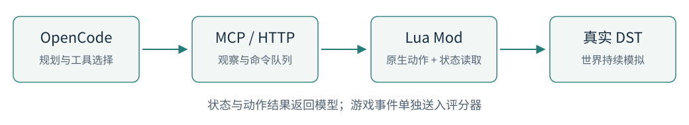
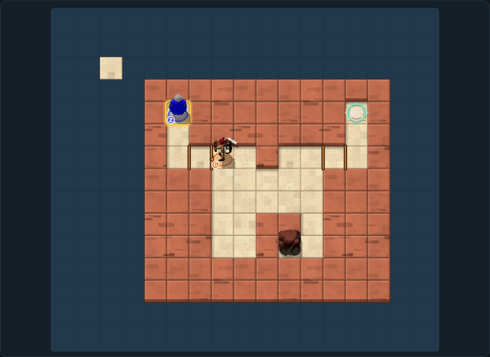

[下载排版版 PDF](Game_Bench_Harbor_Report.pdf) · [原始工程审计](TECHNICAL_AUDIT.zh-CN.md)

游戏环境 Agent Benchmark

# 两类游戏， 两种 Sandbox

饥荒与沉星之序的环境构造、任务设计及模型实测

同样是让 Agent 玩游戏，开放世界和规则谜题需要保留的复杂性并不相同。我的选择是：在饥荒中部署真实游戏，在沉星之序中复现一个边界清晰的关卡。

饥荒的难点来自持续变化的世界。树、草、燧石、工具、食物与火源有不同的交互方式，角色还受到昼夜和饥饿的约束。若自行重写这些机制，很容易把真正要测试的生存压力简化掉。因此，我保留原游戏模拟，通过 Lua 桥接读取状态、执行原生动作。

沉星之序的核心则更接近规则驱动的空间谜题。对选定关卡而言，棋盘有限，动作集合较小，角色和物件的交互可以写成明确的状态转移。我用 Agent 编写、调试关卡复现，结合自己的规则理解与网上攻略补充约束，再用参考解和轨迹重放检查实现。

2

Harbor 任务切片

0.30

DST 本轮 reward

0.24

沉星之序轨迹 v2 重评分

### 这份报告讨论什么

首先比较游戏结构与 Agent 能力要求；然后说明两套 sandbox 的实现取舍；最后介绍任务、reward 和 Harbor + OpenCode 实验，并对照游戏截图与模型推理，分析哪些行为得了分、哪些行为没有完成目标。

模型采用 DeepSeek V4.1 Flash（配置显示名称，API model ID 为 deepseek-flash），开启 thinking、reasoning_effort=low。两条模型轨迹均未通关。沉星之序的 0.24 是同一历史轨迹的 Judge v2 重评分，原始终局分仍为 0；它与 DST 的 0.30 不能直接横向比较。

01 / 游戏差异

## 一个世界在继续运转， 一个棋盘等待下一步


图 1　真实 DST 客户端。模型已完成材料收集和制斧，角色仍需继续取得木材、建火并应对夜晚。截图取自本轮原始录像，约 04:10。


### 有限规则，组合空间仍然很大

沉星之序复现的是 Heroes and Artifacts 7：两名角色、两个出口、巨石和 Rod。每次只执行一个离散动作，棋盘随后进入下一个状态。

动作少不意味着规划简单。一次交换或推动可能让眼前的位置更好，却破坏另一名角色的通路。难点在于理解规则，并安排多个物件与角色的先后关系。

图 2　本项目复现关卡的初态：两名角色需要借助巨石与 Rod，分别到达两个出口。

01 / 从游戏结构到任务切片

## 保留什么复杂性， 就考察什么能力

| 比较项 | 饥荒 / DST | 沉星之序关卡 |
| --- | --- | --- |
| 环境结构 | 开放世界，局部可见；资源、角色与昼夜持续变化。 | 有限棋盘；角色与物件遵循显式规则。 |
| 动作空间 | 移动、采集、拾取、制作、装备、砍树、进食、烹饪、加燃料等；动作带实体或坐标参数。 | 四方向移动、角色切换、激活、撤销、重置，共 8 个离散动作。 |
| 时序 | 实时模式；推理延迟原则上也消耗生存时间，动作还可能处于执行中。 | 离散步进；模型思考时棋盘保持不变，动作执行后才转移状态。 |
| 关键能力 | 局部探索、资源依赖规划、对象交互、动作完成判断、生存压力下的调度。 | 未知规则归纳、角色与朝向跟踪、空间推演、跨角色的因果规划。 |
| 主要风险 | 观察已经过时；动作没做完；资源掉在地上却误认为已取得。 | 局部移动正确，但全局布局错误；混淆当前角色，反复撤销或重置。 |

### DST：选择首夜生存

不评测从菜单到长期基地建设的完整流程，而从第 1 天清晨、空背包开始。任务要求采集、制斧、收集木材、建火并活到次日。这个切片保留了材料与工具的依赖关系，也留下明确的时间压力。

### 沉星之序：选择双角色关卡

不评测整部游戏的所有世界，而固定一个需要角色协作的棋盘。终局要求两名英雄同时到达两个不同出口，避免把“某一个角色到达终点”误判成通关。

**两种任务的区别也决定了 Judge 的形式。**饥荒适合通过真实游戏事件检查采集、制造和存活；棋盘谜题适合从初态重放整条动作序列，再检查终局位置。

当前两任务的观察模态并不相同：DST 模型接收结构化局部状态；沉星之序模型接收棋盘截图和公开反馈。DST 有录像，不代表本轮模型通过画面完成感知。

02 / Sandbox 构造

## 饥荒：部署原游戏， 在模拟内部建立接口

对饥荒，我没有复写世界模拟。正版 Linux 客户端在 A800 上以单人离线世界运行，Xvfb 提供显示环境，Lua 代码在主模拟端访问角色和实体。外部 Agent 通过 MCP 调用观察和动作工具，HTTP 服务负责交换状态与命令。



### 把“按键”提升为游戏动作

桥接层将命令转成游戏原生的 `BufferedAction`、寻路和 `Builder` 调用。例如，`pick` 用于植物采集，`pickup` 用于拾取地面物品；`craft` 检查配方和材料，再由原游戏消耗材料。模型无需处理每一次鼠标定位，但仍要选对对象和动作。

| 接口约束 | 本轮设置 |
| --- | --- |
| 局部观察 | 半径 25 世界单位；背包、生命/饥饿/理智、附近实体与制作配方。 |
| 移动与建造 | 单次移动不超过 30 单位；建造点距角色不超过 6 单位。 |
| 采样与录制 | 状态每 0.5 游戏秒采样；命令每 0.25 游戏秒轮询；录像为 10 FPS。 |
| 调用返回 | 等待 0.5–15 墙钟秒后返回状态；返回时原生动作可能尚未完成。 |

### 固定 seed 之外，还要保存完整起点

本轮 seed 为 **341784114**，build 为 **762172**。我封存了世界和 Wilson 的完整快照：第 1 天秋季清晨、空背包、生命 150、饥饿 150、理智 200。只固定地图 seed，无法固定已经被采走的资源、角色位置和游戏时钟；重复实验应恢复同一份存档。

这种实现保留了原游戏机制，但增加了工程责任：启动握手、暂停状态、异步动作完成和旧状态失效都需要处理。本轮启动时曾修复暂停同步，自动按 trial 恢复基线还未接入；这些影响保留在实验记录中。

02 / Sandbox 构造

## 沉星之序：用 Agent 把关卡规则复现出来

沉星之序采用了另一条路线。我把 Agent 的试玩与调试、自己对关卡的理解、网上攻略中的解题先验结合起来，在公开引擎与关卡资料基础上复现固定棋盘。Agent 负责生成和修改代码，我负责补充机制约束、检查异常，并判断局部实现是否符合预期。


### 把规则拆成可以检查的状态转移

实现分为棋盘数据、转移规则和渲染三部分。`board.json` 保存固定布局；Joric 引擎与关卡扩展处理行走、Wizard 交换、Rod 推动以及切换、撤销和重置；浏览器渲染棋盘和 HUD，MCP 只向被测模型返回截图与公开动作反馈。

棋盘状态可以写成 `sₜ₊₁ = T(sₜ, aₜ)`。同一个初态、相同的动作序列，应得到相同的结果。这个性质使逐步调试和整条轨迹重放都更直接，也让 Judge 能指出“哪一步开始与记录不一致”。

### 攻略用来校验实现，不作为模型的答案提示

网上攻略提供了解题路径和机制线索，可帮助构造一个成功参考轨迹。参考路径展开角色切换后，共 97 个 MCP 动作。我把它放在 `solution/` 中验证环境与 Judge；模型评测时不提供这条参考解。发布版通过 Harbor 执行参考解，得到 **reward=1.00、0 个运行异常**。

**这条路线节省了什么**

不必自动化商业客户端的登录、菜单与存档页面；规则、初态和动作转移都能由代码控制。更适合做确定性空间推理切片。

**它要求额外证明什么**

参考解能通关，只证明这套实现内部可用。若要声称与商业原版完全一致，还需逐项对照交换、推动、边界、朝向等规则。

复现使用的公开代码保留原许可。攻略与关卡展示参考 WikiTactics；这里的“我用 Agent 复现”指实现和验证工作，不把第三方引擎或原作规则宣称为原创。

03 / 任务与 Reward

## 奖励应对应已经发生的进展

### DST：首夜任务的依赖链

目标是从空背包建立营火，并活到第 2 天清晨。奖励按一次性里程碑累计，重复制作、丢下再捡起不会重复计分；只有满足全部前提并健康存活，才能得到最后的终局奖励。

| DST 判据 | 奖励 | 游戏端证据 |
| --- | --- | --- |
| 曾分别持有草≥3、树枝≥1、燧石≥1 | 0.10 | 背包数量历史最大值 |
| 自己制作斧头 | 0.20 | builditem(axe) |
| 制斧后背包持有木材≥2 | 0.15 | 背包数量 |
| 自己建造营火 | 0.15 | buildstructure(campfire) |
| 夜间在自己的燃烧营火 6 单位内累计≥30秒 | 0.10 | 时钟、距离和燃烧状态 |
| 全部达成；次日清晨存活，生命≥50、饥饿≥20 | 0.30 | 世界周期与角色状态 |

### 沉星之序：终局条件与关卡过程分

通关要求两名英雄同时占据两个不同出口。Judge v2 先校验轨迹，再对每个单一状态计算进展，整条轨迹只取最大值。重置、撤销和反复进入同一状态不能累积奖励。

| 同一状态中达到的进展 | 分数 |
| --- | --- |
| 任一英雄取得 Rod / 巨石向左移动至少两格 | 0.05 / 0.18 |
| 一名英雄进入出口 / 巨石进入左出口接近通道 | 0.24 / 0.40 |
| 两人分别进入两侧出口列接近区域 | 0.55 |
| 一人在出口，另一人距另一个出口一步 | 0.75 |
| 两人同时占据两个出口 | 1.00 |

这些过程分是关卡专用的诊断量。v2 对已有轨迹的评分属于事后重评，不替换历史在线结果；阈值仍需用更多合法解法和失败轨迹校准。

03 / 实验组织

## Harbor 管试验，OpenCode 管交互


两任务均使用 Harbor 组织环境、执行 Agent 并收集 verifier 输出。OpenCode 2.2.5 作为 harness，负责维持模型上下文、展示 MCP 工具和执行工具调用。模型为 DeepSeek V4.1 Flash（配置名称），API 标识 `deepseek-flash`；thinking 开启，reasoning effort 为 low。

### 任务目录

```text
task/
├── task.toml
├── instruction.md
├── environment/
├── solution/
└── tests/test.sh
```

### 每部分负责什么

`task.toml` 描述资源与时限；`instruction.md` 给出目标与约束；`environment/` 构建交互环境；`solution/` 放参考解；`test.sh` 调用 Judge，将结果写入 Harbor 读取的 `reward.txt`。

| 实验设置 | DST | 沉星之序 |
| --- | --- | --- |
| 观察与时序 | 局部结构化状态，实时运行 | 截图与反馈，离散步进 |
| 本轮结果 | 0.30；未通关 | 历史终局 0；v2 重评 0.24 |
| 动作数 | 34 次提交 | 222 次 |
| 约束 | 本轮调整至 500k 累计 API token；1800秒墙钟 | 300 次动作；1800秒墙钟 |
| 验证方式 | 可信游戏事件与独立 scorer | 重放所有动作，核对状态与终局 |

### 两类 Judge 的可信性不同

DST scorer 不重建整个游戏，而信任独立观察器产生的事件；因此日志写入权必须与 Agent 隔离。沉星之序可以重新执行每步动作，并独立检查两出口条件；但重放仍使用同一转移实现，不能用“重放通过”证明原版规则完全正确。

本轮 DST 的 50k 草案预算在调通阶段改成 500k，启动也出现暂停同步修复。最终累计 524,901 token，在途请求越过阈值后停止；Harbor 记录一次退出异常，但 verifier 得分为 0.30。以下分析保留这些实验条件，不将其当作严格控制变量的模型比较。

03 / DST 轨迹分析

## 能完成工具前置， 却没有完成“砍树—拾取”


图 3　最后阶段的真实游戏画面。树已砍倒，木材留在地上；背包里有草和斧头，但没有达到“持有 2 根木材”的条件。

| 步骤 | 动作与反馈 | 计分结果 |
| --- | --- | --- |
| 8–18 | 移动、采草并寻找燧石；对地面燧石从 pick 改为 pickup。 | 材料 +0.10 |
| 19 | craft(axe)，真实消耗材料，触发制作事件。 | 制斧 +0.20 |
| 20–22 | 装备参数曾用错；随后靠近并砍树。 | 无新增奖励 |
| 23–34 | 循环砍同一实体，没有转去拾取掉落物。 | 最终 0.30 |

> “Let's loop chop until log appears in inventory or tree gone, max 12 swings.”DeepSeek 原始推理摘录，砍树循环之前。

模型的停止条件是“背包出现木材”或“树的 ID 消失”。但砍树不会自动把木材放入背包，倒下后的实体 ID 也仍存在。最终观察中该对象已是 `chop=false`，附近有地面 log；循环却没有使用这一变化。关键失误是没有把掉落与拾取当成独立阶段。

桥接层也有责任：无效持续动作仍显示 running，没有及时返回明确失败。因此，这次循环不能全部归因于模型。终止发生在白天，原因是 token 预算；它没有检验模型真正进入夜间后的生存表现。

03 / 沉星之序轨迹分析

## 一个角色到了出口， 整体布局仍没有解开



0.24

第 140 步达到的最佳里程碑

蓝色 Wizard 已进入左侧出口，另一名角色仍在中部，巨石没有进入左出口接近通道。

这说明模型能修正局部位置、使用角色机制，却尚未把两个角色和巨石组织成一个共同可完成的布局。

图 4　第 140 步的关卡状态。单人进入出口得 0.24；两人同时到达才算成功。

> “Oops active hero was Gemsman, not Wizard! We forgot switch after activate…”DeepSeek 原始 reasoning 事件 57，对应第 138–140 步；随后执行角色切换并继续移动。

这段推理显示模型能从受阻反馈中发现角色混淆。纠正之后，它确实让一名英雄到达出口，因而 0.24 有明确的行为依据。但局部纠错并没有解决巨石布局：222 次动作里，巨石只出现在初始位置和右侧一格，没有形成进入左侧通道的安排。作为对照，成功参考在第 31 步已把巨石向左移动两格，第 70 步进入左出口接近通道。模型没有完成这段空间准备。

| 轨迹现象 | 证据 | 反映的问题 |
| --- | --- | --- |
| 能使用机制 | 128 次有效行走、7 次交换、4 次 Rod 推动 | 已能正确使用部分局部机制 |
| 反复回退与试探 | 6 次重置、10 次撤销、39 次未改变局面 | 角色状态跟踪和预期结果检查不稳 |
| 缺少全局进展 | 巨石未进入左侧关键通道 | 局部有效动作没有组成完整的因果计划 |

成功参考轨迹 97 步、reward=1.00。它验证了一条可行解，但不是模型必须逐步模仿的唯一答案。当前只分析一条 thinking-low 轨迹，不能据此估计模型的一般通关率。

讨论 / 与游戏 Agent Benchmark 对照

## 局部能力如何转化为完整任务

本轮 DeepSeek 已能完成部分材料准备、工具使用与局部纠错，但没有持续把观察变化转化为推进终局的动作。结合其他游戏 Agent benchmark，更有解释力的判断是：局部能力已经显现，状态更新、反馈利用和多步计划之间的衔接仍不稳定。

### 从“知道怎么做”到“在当前局面做对”

BALROG 在 NetHack 等游戏中观察到 knowing–doing gap：模型能回答机制问题，却在实际行动中违反这些知识；其轨迹分析还指出复杂空间推理和系统探索的困难。[1] 本轮 DST 在制斧之后，没有根据 chop=false 与地面 log 切换到拾取，说明动作计划未随状态更新。这个案例可以借用上述框架解释，但我们没有单独测试该模型的机制知识，因此尚不能断言它“明知故犯”。

### 局部进展与完整通关应分别衡量

GameWorld 发现，Agent 经常取得部分进展，却难以稳定完成全部目标；其分析强调动作落实、轨迹记忆和长程执行的可靠性。[2] 本轮沉星之序能交换、推动和纠正角色混淆，但巨石始终没有进入左侧关键通道。0.24 说明它实现了一个局部里程碑，并不表示已经完成约四分之一的解题计划；过程分与终局成功应同时报告。

### 失败发生在模型与交互系统的共同作用中

GameWorld 还将实时环境中的推理延迟纳入任务难度，指出接口与记忆设置会影响表现。[2] 本轮 DST 的 running 反馈未明确暴露目标失效，且预算在白天耗尽。由此应优先检验动作状态是否清晰、模型是否使用最新观察，不能把所有重复动作归结为模型能力，也不能据此评价它的夜间生存决策。

据此，下一轮应检验三个改动：显式保存角色与关键物件状态；执行短计划后核对预期变化；连续无进展时停止重复并重新规划。用固定初态、多次试跑和消融对照衡量效果。这些是由本轮轨迹与外部研究提出的待验证假设；两条 thinking-low 轨迹不足以推断 DeepSeek 系列的一般能力或模型排名。

[1] [BALROG，§4.1 Qualitative analysis](https://arxiv.org/html/2411.13543v1#S4.SS1)

[2] [GameWorld，§4.5 与 §7](https://arxiv.org/html/2604.07429v1)

讨论 / 复现入口

## 下一步应先修什么

这两次失败分别说明：开放世界需要可靠地判断“动作是否真的完成”，规则谜题需要把局部机制组织成整体计划。Sandbox 既要保留这些困难，也要避免把接口错误算到 Agent 头上。

### DST 的优先项

先把每局恢复快照和启动握手自动化，在模型开始前确认时间持续推进。再为动作增加明确的完成、失败和目标失效状态；树倒下后应提示需要拾取，而不是一直保留 running。

补充一次从真实采集到首夜成功的参考策略，核验 reward=1、死亡和空等的反例。如果评测目标包含视觉感知，还应新增截图输入组，与当前结构化观察组分开报告。

### 沉星之序的优先项

先逐项核对移植规则，特别是交换、推动、朝向、角色切换与撤销。保留固定初态和逐步重放，以便区分规则错误与策略错误。

模型侧应显式记录当前角色、持有物、朝向以及关键物件位置；每段短计划执行后检查预期变化。再用多个固定关卡与多次运行，验证这些改动能否改善全局规划。

### 本次工作的范围

我完成了两种 sandbox 路线的实现与接入，保存了模型的实际推理、动作和状态，并把 Judge 与视频复盘连在一起。DST 使用真实游戏模拟；沉星之序是由 Agent 辅助、结合人类先验和公开资料完成的固定关卡复现。两者都提供了可检查的失败案例，但还不能据两条轨迹判断模型的普遍能力。

**复核结果：**DST 事件重算与 Harbor verifier 均为 0.30；沉星之序模型旧轨迹 v2 重放为 0.24；发布版参考解通过完整 Harbor trial，得分 1.00、0 个异常。新报告没有新增模型试跑，也没有改写旧实验得分。

### 代码、视频与参考资料

代码与完整证据：[github.com/CostaliyA/game-bench-harbor](https://github.com/CostaliyA/game-bench-harbor) 镜像归档：[huggingface.co/datasets/CostaliyA/game-bench-harbor-images](https://huggingface.co/datasets/CostaliyA/game-bench-harbor-images)

关卡与攻略参考：[WikiTactics · Heroes and Artifacts 7](https://sinkingstar.wikitactics.com/areas/heroes-and-artifacts/#heroes-and-artifacts-7)。复现所使用的公开引擎许可保留在仓库的 JORIC-LICENSE。视频根据保存的动作与状态重放。

框架参考：[Harbor Tasks](https://docs.harborframework.com/tasks/overview)；[DeepSeek Thinking Mode](https://api-docs.deepseek.com/guides/thinking_mode/)。实验输入、原始 reasoning、完整动作轨迹和历史报告均保存在 results/；视频字幕是原始推理的摘要，不替代原文。

日期：2026 年 11 月 15 日。实验机器：a800-server1。Docker 发布镜像不包含 Steam 登录信息、商业游戏本体或私有起点存档。详细工程审计与复现限制另见仓库原技术报告及交付指南。
