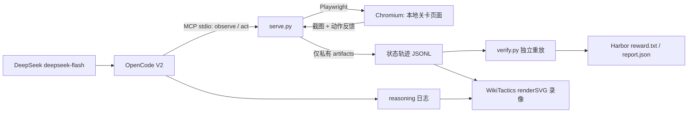

# Heroes and Artifacts 7：环境、Judge 与模型分析

> 版本：2026-11-15。评测对象是本地网页移植关卡；WikiTactics 画面用于回放可视化。原始关卡与素材参考：[WikiTactics 第 7 关](https://sinkingstar.wikitactics.com/areas/heroes-and-artifacts/#heroes-and-artifacts-7)。

文件入口：[Harbor 配置](../job.yaml) · [MCP 服务](../tasks/heroes-artifacts-7/environment/serve.py) · [独立重放校验器](../tasks/heroes-artifacts-7/tests/verify.py) · [当前 Judge v2](../tasks/heroes-artifacts-7/tests/judge_v2.py) · [WikiTactics 视频](../videos/wiki-render-replay.mp4)。

## 1. 环境与交互架构

- **关卡代码**：`tasks/heroes-artifacts-7/environment/game/` 含 `board.json`、`joric-engine.js`、`game.mjs`、`view.mjs` 与页面。`game.mjs` 实现 Gemsman 行走、Wizard 直线交换、Rod 推动、切换、撤销和重置；`view.mjs` 绘制画面与 HUD。`JORIC-LICENSE` 随代码保留。此版本是基于关卡数据的网页重建，物理规则仍需与原游戏逐项比对。
- **模型动作面**：`serve.py` 通过 FastMCP 暴露 `observe()` 和 `act(action)`。`act` 只有 `up/down/left/right/switch/activate/undo/reset` 八个离散值。每次返回 920×930 的棋盘与 HUD 截图、当前英雄及动作反馈；不提供参考网页右侧的操作栏，也不提供隐藏状态工具。服务端限制 300 次动作、1800 秒；重置和撤销照样消耗动作。
- **运行容器**：`environment/Dockerfile` 基于 A800 现有镜像 `zyr/harbor-dst-runtime:20261114`，加入 Chromium、Playwright、MCP、Node 22 和 OpenCode 2.2.5。Harbor 0.26.0 读取 `job.yaml`，以 `deepseek/deepseek-flash`、thinking enabled、`reasoning_effort: low` 运行。密钥通过 A800 上独立的 `private/deepseek.env` 注入，未打包。
- **证据边界**：模型只收到截图和公开反馈；`trajectory.jsonl` 的 `before/after` 精确状态写在 `/artifacts`，供试跑结束后私有校验。OpenCode 的 `reasoning` 事件单独提取到 `results/thinking-low-001/reasoning.jsonl`，每段与随后执行的动作编号关联。
- **视频**：`tools/replay_wiki_frames.py` 在 A800 浏览器中调用 WikiTactics 页面公开的 `renderSVG`，把已有轨迹状态转成 223 帧 SVG／贴图截图；`tools/make_wiki_reasoning_video.py` 叠加动作、反馈与对应 reasoning 原文节选。完整原文见 `results/thinking-low-001/reasoning.md`。这一步没有调用模型，也没有让 WikiTactics 的游戏引擎重新判定动作；其交互页在 A800 上一直显示 “Loading our rules”。

## 2. 当前 Judge：可信重放后给终局与过程分

`tests/verify.py` 在独立浏览器中从初始棋盘逐个重放代理动作。它核对棋盘 SHA-256、初始状态、动作白名单与上限、每步前后状态和反馈、最终快照，并单独检查两名英雄是否分别占据两个出口。它先在 `report.json` 中记录终局二值分：双出口同时占据为 1，其余有效试跑为 0。参考轨迹 97 个 MCP 动作得 1，空轨迹得 0，证明终局判分正反例可执行。

`tests/test.sh` 现已接入 `tests/judge_v2.py`：先执行上述独立重放，再由 v2 读取同轮 verifier 写出的 `report.json` 和轨迹，把 `judge-v2.json` 与最终过程分 `reward.txt` 写到 `/logs/verifier/`。Harbor 0.26.0 将 `reward.txt` 解析为浮点数，因此 `0.24` 等分数可直接进入结果。若重放脚本或 v2 脚本失败，`test.sh` 不会留下可被误读为成功的旧奖励文件。历史试跑 `jobs/` 的二值奖励文件保持原值；本包的 v2 分数是对旧轨迹的离线重评分。

## 3. Judge v2 规则：终局优先、过程分封顶

先做完整轨迹校验；无效轨迹直接 0。成功通关直接 1。未通关时，在每个**单一有效状态**上检查以下里程碑，整条轨迹只取最高分，不逐步累加。重置、撤销和重复进入同一状态都无法刷出额外分数。出口坐标为左 `(-6,10)`、右 `(2,10)`；巨石初始 `(-1,4)`。

| 未通关时达到的最高里程碑 | 分数 | 判据 |
| --- | ---: | --- |
| 拿到 Rod | 0.05 | 任一英雄持有 Rod |
| 巨石向左移动至少两格 | 0.18 | 巨石 `x ≤ -3` |
| 一名英雄进入出口 | 0.24 | 任一英雄精确位于一个出口 |
| 巨石进入左出口接近通道 | 0.40 | 巨石 `x ≤ -5` 且 `y ≥ 8` |
| 两名英雄分别进入两侧出口列 | 0.55 | 同一状态下，分别位于 `x=-6` 和 `x=2`，且各自 `y∈[8,10]` |
| 一人已在出口，另一人距另一出口一步 | 0.75 | 同一状态下，一人位于出口，另一人位于另一出口正下方一格 |
| 两人同时占据两个出口 | **1.00** | 终局成功，覆盖所有过程分 |

这些是**关卡专用的诊断性过程分**，不会把某条参考动作序列写成唯一正确路线；其他解法只要通关同样得 1。未通关最高 0.75，保持成功与部分进展的区分。`blocked`、重置、撤销、动作数与独立状态数单列为效率指标，暂不再从过程分扣减，避免把必要探索误判为能力差。生产版还应在校验器中审核 `elapsed_s` 单调且不超过时限；当前接口在运行时限速，但 v1 重放校验没有独立核验时间字段。

v2 对现有证据的离线重评分：

| 轨迹 | 动作 | 历史终局奖励 | v2 重评分 | 最高里程碑 |
| --- | ---: | ---: | ---: | --- |
| 成功参考 | 97 | 1 | 1.00 | 双出口同时占据 |
| thinking-low 模型 | 222 | 0 | 0.24 | 一名英雄进入出口（第 140 步） |
| 非 thinking 模型 | 217 | 0 | 0.05 | 拿到 Rod（第 38 步） |

参考轨迹依次在第 3、31、70、92、94、96、97 步达到上述里程碑。过程分的阈值和权重应先在多条合法解法及失败轨迹上校准；目前只有一条成功参考和两条模型试跑，不能把 0.24 解读为普适成功率。

## 4. 模型关键能力与失分原因

**已表现出的能力。** thinking-low 试跑完成 222 次合法按钮调用，产生 128 次有效行走、7 次交换、4 次 Rod 推动；它在第 140 步让一名英雄抵达出口。222 次动作后的 223 个状态中有 133 个不同状态。对比非 thinking 的单次试跑，后者 217 次动作中有 98 次未改变局面、最高无英雄进入出口；thinking-low 为 39 次未改变局面。两者是不同单次试跑，不能据此单独归因于 thinking 设置。

**主要瓶颈是物件因果规划。** 成功参考在第 31 步把巨石从 `(-1,4)` 移到 `(-3,4)`，第 70 步进入左出口接近通道 `(-5,8)`，然后用交换和 Rod 配合完成双出口。thinking-low 的巨石在 222 次动作中只出现在 `(-1,4)` 和 `(0,4)`，始终没有向左两格，更没有进入左出口通道。它曾多次用 Rod 推动另一名英雄，局部动作有效，却没有建立“先布置巨石、再同时安排两名英雄”的全局依赖链。

**状态跟踪和反复试探消耗了预算。** thinking-low 使用 6 次重置、10 次撤销；39 次操作没有改变局面，其中 34 次是受阻动作、5 次是无效撤销。reasoning 事件 57 在第 138–140 步附近明确写道“Oops active hero was Gemsman, not Wizard! We forgot switch after activate”，与随后补做切换一致。这说明模型能从反馈纠正局部失误，但活跃英雄与朝向的连续跟踪不稳。失败末段又转向把巨石向右交换；该方向没有满足左侧巨石里程碑。以上是这两条轨迹的行为诊断，不是对模型一般能力的统计结论。

## 5. 复现和文件入口

- Harbor 任务：`job.yaml`、`tasks/heroes-artifacts-7/task.toml`、`environment/Dockerfile`、`instruction.md`。
- 判分代码：`tests/verify.py`（终局与轨迹完整性）、`tests/judge_v2.py`（已接入 `test.sh` 的过程分）。
- thinking-low 证据：`results/thinking-low-001/{trajectory.jsonl,reasoning.md,reasoning.jsonl,report.json,judge-v2-prototype.json}`。
- 成片：`videos/wiki-render-replay.mp4` 使用 WikiTactics 渲染；`videos/local-browser-replay.mp4` 使用本地关卡页面渲染。视频只展示 reasoning 末段节选，完整原文见证据文件。
- 素材和来源：`resources/reference-actions.json`、`resources/wiki-initial-board.svg`、`resources/SOURCES.md`。

若需新试跑，在 A800 的 `/root/zyr/ootss-harbor` 使用独一无二的 `--job-name` 运行 Harbor；不要把 `private/deepseek.env` 或 API 密钥复制进交付包。现有视频和 v2 离线重评分均可直接查看，无需再次调用模型。
