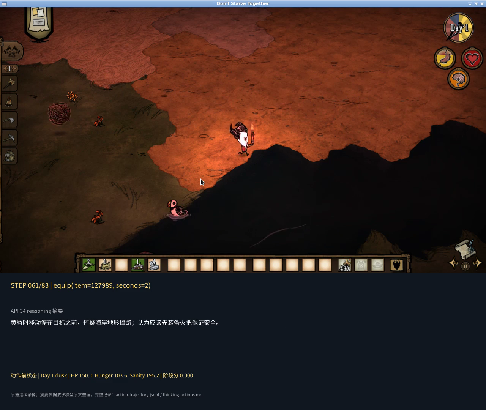

# DST 科学营地 v1：首轮结果与完整证据

2026-11-16，新任务 `dst-science-settlement-v1` 已由 DeepSeek Flash 经 Harbor / OpenCode 跑至自然终局：**reward = 0.000，success = false，第一夜死亡，Harbor 异常 0**。旧首夜任务的 **1.00** 成绩保留；这是目标、观察与动作接口都有扩展的新任务，两次分数不能直接当作同一任务的退步幅度。

本轮主要失败在基础生存：提前消耗唯一的火把，未备齐替代照明材料，沿海探索受阻；模型还误读了已装备状态、重复使用了错误的装备参数。它没有推进到挖矿和科技营地阶段，因此这次 0 分**不能证明后半段挑战已被合理校准**。本轮仅有一次正式模型试跑，未因失败而重跑或调整评分。

## 更难的任务与固定 reward

从固定世界第 1 天清晨、空库存和满状态出发，要求在**第 3 天清晨**完成一个有科技、装备、食物与燃料储备的营地，连续经历两个夜晚。模型思考期间游戏继续运行。任务原文见 [instruction.md](used-runtime/tasks/dst-science-settlement/instruction.md)，实际评分见 [reward.py](used-runtime/tasks/dst-science-settlement/tests/reward.py)。

| 一次性目标 | 分值 | 本轮 |
|---|---:|---|
| 自制斧头和镐子，两者都完成 | 0.05 | 未尝试 |
| 制镐后同时持有金块 ≥1、石头 ≥4 | 0.10 | 未完成 |
| 自建科学机器 | 0.15 | 未尝试 |
| 自制并装备背包 | 0.10 | 未尝试 |
| 自制长矛 | 0.10 | 未尝试 |
| 自建火坑，距自己的科学机器 ≤12 单位 | 0.10 | 未尝试 |
| 进食实际恢复饥饿值累计 ≥60，溢出不计 | 0.10 | 未进食 |
| 第一夜在自己的有效光源下累计 ≥30 游戏秒 | 0.025 | 0 秒 |
| 第二夜在科学营地燃烧火坑附近累计 ≥30 游戏秒 | 0.025 | 未到达 |
| 第 3 天清晨，全部里程碑及终局条件同时成立 | 0.25 | 未到达 |

终局还要求生命 ≥100、饥饿 ≥75、理智 ≥100；科学机器与火坑仍在，人在营地；自制背包仍装备、自制长矛仍持有；现存木材 ≥6、草 ≥6、树枝 ≥4，以及按当前新鲜度折算的食物饥饿值 ≥25。历史最大库存和已经吃掉的食物不能充当储备。

这一设计增加了探索、资源分配、科技依赖、返营和跨昼夜计划的要求。阶段奖励合计 0.75，最终共同条件占 0.25；重复制作不重复加分，死亡保留已获阶段分，但永远不算成功。没有终止事件的运行按基础设施未完成处理，不冒充有效 0 分。本轮的火把本身不在奖励表中，未拿到任一里程碑，所以得分为 0。

## 运行与用量

| 项目 | 实测 |
|---|---|
| 模型 API 返回名称 | `deepseek-flash`（配置名称 DeepSeek V4.1 Flash） |
| Agent / 调度 | OpenCode 2.2.5 / Harbor 0.26.0 |
| 输入 | 半径 25、最多 90 个附近实体的结构化观察；没有图像输入 |
| 配置窗口 / 输入上限 / 输出上限 | 500,000 / 495,904 / 4,096 tokens |
| thinking | enabled，reasoning effort low |
| 实际最大单次 prompt | **44,150 tokens** |
| 原始 API 请求 / 完成 | **45 / 45** |
| prompt / completion / total | **1,143,315 / 20,777 / 1,164,092 tokens** |
| 其中 reasoning tokens / prompt cache hits | 13,105 / 1,120,000 |
| 游戏动作 / 返回记录 | **83 / 83** |
| 启动至死亡 | 墙钟 446.27 秒；游戏 439.00 秒 |
| Harbor trial | `dst-science-settlement__3xSKbEr`，1 个完成，0 个异常，0 次重试 |
| 终局 | cycle 0，night，HP 0，hunger 81.40625，sanity 154.39722 |

**500k 是配置上限，不是本轮实际使用的上下文长度，也不是累计用量限制。** 用量取完整代理 API 记录的 usage 累加；Harbor 自身的统计口径不同，原始 [job-result.json](harbor/job-result.json) 另行保留，不能用其 output 字段替代包含 reasoning 的 API completion 用量。

动作分布：拾取 9、采集 14、移动 20、等待 36、制作 2、装备 2。两次制作都是火把，不是斧头或镐子。动作返回时有 success 43、error 12、failed 2、running 11、moving 15；这是**调用返回瞬间**的状态，原生动作可能稍后完成，不能把它直接当作最终动作成功率，也不能将所有 wait 视为浪费。

## 关键 action 与 reasoning

下列时间对应注释视频，原速播放。推理摘要只概括该动作之前模型实际返回的 reasoning；“事后核对”是本报告分析，两者分开。

| 视频时间 / 步骤 | 模型当时的意图与动作 | 事后核对 |
|---|---|---|
| 00:08 / 1 | 核算工具、科技和营地材料；先收集附近物资，再探索矿区 | 整轮结构化观察见到过 34 株树苗、32 处草、8 个燧石实体，但没有见到矿石或金块资源；这些是局部观察累计，不是全图统计 |
| 01:40 / 25 | 移动结果与预期不符，怀疑坐标含义或碰撞绕行 | 本次移动超过 30 单位，被接口明确拒绝；后续仍出现类似错误 |
| 03:03–03:05 / 44–45 | 沿途采多汁浆果，再继续探索 | 采集后地上出现 `berries_juicy`，库存没有浆果；模型未追加拾取掉落物 |
| 04:25 / 55 | 认为现有草和树枝够造火把，先准备照明再探索 | 火把随后制作成功并自动装备，开始消耗燃料 |
| 04:30 / 57 | 看到此前返回库存似乎没变，怀疑制作没成功，重试 | 此刻观察中火把已 `equipped=true`、`burning=true`、燃料约 96%；重复制作因材料不足失败 |
| 05:05、05:11 / 61、63 | 认为需要装备火把，等待后再次尝试 | 传了 `item` 而不是工具说明要求的 `target`，两次报错；火把其实早已装备，燃料约 51% / 43% |
| 05:53 / 69 | 从西侧寻找向北通路，并担心入夜前火把耗尽 | 目标点不是陆地，被拒绝；火把已不在库存中。视频可见海岸，绕行问题有画面支持 |
| 07:20 / 82 | 夜里被地形阻挡，缺乏照明材料，尝试拾取萤火虫 | 拾取失败；没有获得替代光源 |
| 07:22–07:26 / 83 至终局 | 等待、观察，最后承认无材料可救场 | HP 从 150 降到 49.95，随后终止事件为死亡、HP 0 |

首夜死亡发生于无照明状态，生命骤降及画面与黑暗伤害吻合，模型也在原始 reasoning 中如此判断。终止事件没有独立 `killer` 字段，因此死因归纳来自状态、视频与轨迹的联合证据。最后一次普通状态采样还可能显示 HP 49.95；最终评分使用随后到达的死亡事件 HP 0，并非混用两次终局。



模型在自己的工具代码中多次把观察投影为只含物品名称和数量的列表，遗漏了原始观察里的装备、燃料等字段。这使“做完动作后检查实际状态”的环节失效。导航和配方计划也没有转化为足够的实物库存：终局只有草 1、种子 2、花瓣 1、燧石 4；没有木材和树枝，进食恢复量为 0，食物储备只有 9.375 饥饿值。

接口本身也有需要后续处理的边界：v1 没有单独的 `unequip` 动作，`pickup` 观察标记对部分鸟类等实体过宽，而动作层会拒绝它们；`move` 返回仍为 moving 时也不能仅凭标签判断进度。这些因素应计入后续评估界面审查，不能全归咎于模型。它们没有在本轮中途修改。

## 冻结、预检与限制

- 源码在首个模型请求前冻结于 **2026-11-16T02:41:07.593127Z**，代码提交 `b54ad3f`；[protocol-manifest.json](protocol-manifest.json) 记录 25 份代码、任务与配置的 SHA-256。[used-runtime/](used-runtime/) 是实际运行快照。
- 8 项评分单元测试通过；隔离游戏机制预检 18 项、0 错误，检查原生挖矿、科技链、装备、背包容量和烹饪等。证据见 [validation/](validation/)。这不等于完整成功 oracle。
- 预检使用可丢弃世界中的测试材料，结束后恢复完整原始世界存档并重启客户端。正式开始前校正到第 1 天清晨、原始起点、空库存和满状态；正式模型运行期间没有人工游戏动作。
- 桌面输入控制在桥接中关闭，防止残留按键干扰。游戏本身的耗材、生命、移动速度、动作时长和科技约束保留。开始与终局暂停属于环境生命周期，不是模型可用动作。
- 初次 watchdog 启动早于桥接服务，准备阶段重启后正常；发生在模型调用之前。本轮 Harbor 没有执行异常，但仍依赖人工准备固定世界，尚未实现完全自动的跨 trial 复位。
- **尚无从自然起点完成全部目标的成功 oracle，也没有多种子/多次成功率。** 这轮没有进入科技阶段，下一步应先证明固定世界中完整目标可达，再用同版协议重复评估。若修改接口或任务，应另立版本，保留本轮结果。

## 视频、轨迹与复算

- **[Action / reasoning 注释视频](../../videos/dst-settlement-v1-annotated.mp4)**：7 分 34.3 秒，1280×1080，原速 10 FPS。全部 83 步标注参数和动作前状态；21 步使用实际 reasoning 的中文摘要，其余使用原文摘录。同一个模型返回批量提交的动作共享该次 reasoning。
- [原始录像](https://github.com/CostaliyA/game-bench-harbor/releases/download/dst-settlement-v1-20261116/dst-settlement-v1-original.mp4)：9 分 30.7 秒，1280×720，原速 10 FPS。原文件完整保留；注释版只删除死亡后 8 秒以外的冗余暂停尾帧，不删减游戏过程、不加速。[时间信息](video-timing.json) 与 [视频校验](video-artifacts.json) 单独保存。
- [完整逐 action 轨迹](action-trajectory.jsonl)、[全部模型 reasoning / 工具代码](thinking-actions.md)、[原始 API 请求与 SSE 返回](api/)、[动作](actions.jsonl)、[动作返回](action-results.jsonl)、[状态](states.jsonl)、[评分事件](events.jsonl)。原始 API 返回完成时间在复制前记录，字幕按服务器同一时钟对齐；没有把文件下载时间当作动作时间。
- [分析数据](analysis.json)、[独立重算奖励](reward.json)、[Harbor 原始证据](harbor/)、[字幕源](annotations.ass) 与 [中文摘要](reasoning-summaries.json)。字幕制作发生在运行后，不修改冻结协议。

服务器上的绝对路径：

```text
/root/zyr/harbor-dst/steam-data/dst-settlement-v1/run-001-settlement-v1/episode-annotated.mp4
/root/zyr/harbor-dst/steam-data/dst-settlement-v1/run-001-settlement-v1/episode.mp4
```

从仓库根目录离线复算，无需模型和游戏：

```bash
python3 scripts/analyze_dst_settlement.py results/dst-settlement-001
# 预期 complete=true, terminal=death, success=false, reward=0.0
```

新的在线运行需准备独立、已复位的正版 DST 环境，按 [运行说明](../../runtime/dst-settlement/README.zh-CN.md) 使用 [配置](../../configs/dst-settlement500k.yaml)。不要直接对本轮死亡后的世界再次发起 trial。凭据、Steam 账号目录、游戏本体及私有基线存档不在公开交付中。
